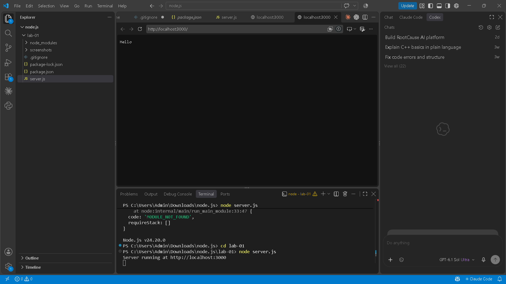
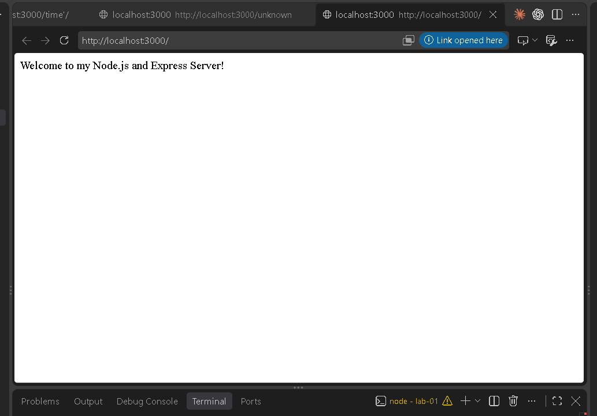
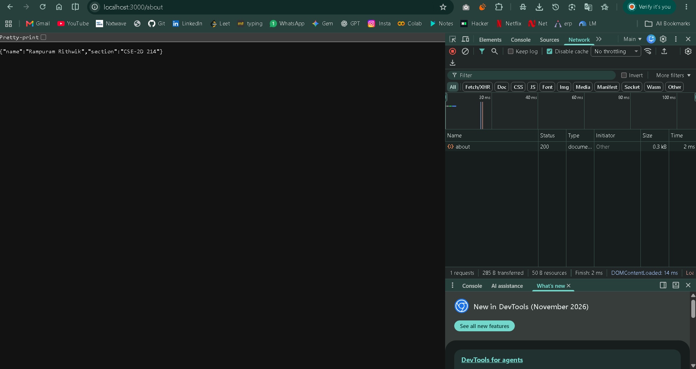
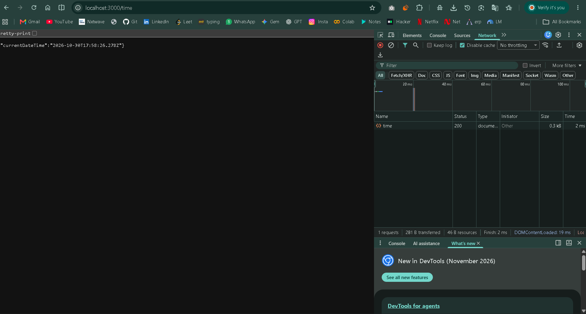
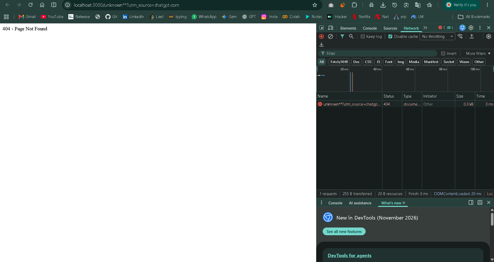

# Lab 1: Node.js and Express server

**Name:** RAMPURAM RITHWIK  
**Registration Number:** 252U1R1213  
**Section:** CSE-2D 214

## Live Deployment Link

Deployment URL: https://rithwik-lab-01.onrender.com/

## Objective

To create a basic web server using the built-in Node.js HTTP module and an Express.js server with multiple API endpoints and proper HTTP status codes.

## Technologies Used

- Node.js
- Express.js
- JavaScript
- npm
- Visual Studio Code

## Installation and Execution

### Prerequisites

- Node.js and npm installed

### Steps

1. Clone the GitHub repository after it has been uploaded.
2. Open a terminal in the `lab-01` folder.
3. Install dependencies:

```bash
npm install
```

4. Run the basic HTTP server:

```bash
node server.js
```

Open http://localhost:3000 and check the Hello response. Stop it using Ctrl+C before starting Express.

5. Run the Express server:

```bash
node app.js
```

6. Open http://localhost:3000 in your browser.

### Environment Variables

- `PORT` (optional): Port for the Express server. Defaults to 3000.
- No other environment variables are required.

## API Endpoints

| Method | Endpoint | Description | Expected Status |
|---|---|---|---|
| GET | / | Displays a welcome message | 200 |
| GET | /about | Returns name and section in JSON format | 200 |
| GET | /time | Returns the current date and time | 200 |
| GET | /unknown | Demonstrates the 404 response for an unknown route | 404 |

## Screenshots

### Basic Node.js HTTP Server


### Home Endpoint


### About Endpoint


### Time Endpoint


### 404 Not Found


## Notes

- Initialized the Node.js project using `npm init -y`.
- Installed Express using `npm install express`.
- Created the basic HTTP server using `http.createServer()`.
- Built the Express server with three API endpoints and a 404 handler.
- Verified successful endpoints return HTTP 200 and unknown paths return HTTP 404.
- Captured screenshots of the working outputs.
- Problems faced and solutions: [WRITE YOUR ACTUAL PROBLEMS AND HOW YOU SOLVED THEM].
- Deployment status: Pending. Update this section after deployment. If deployment is not possible, explain why and add Postman screenshots of every endpoint.

## Security

- `node_modules/` and `.env` are excluded using `.gitignore`.
- No passwords or secrets are included in this repository.
