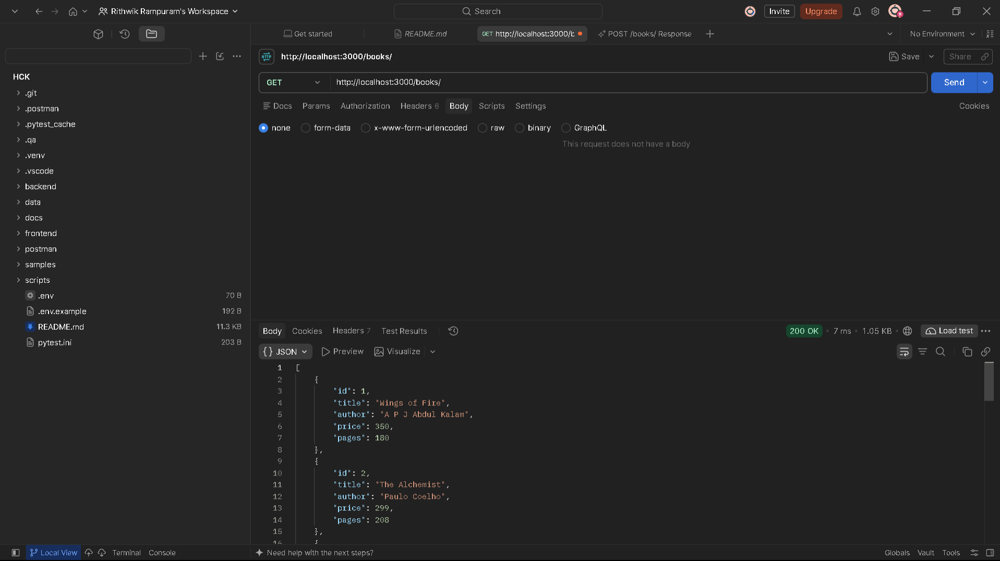
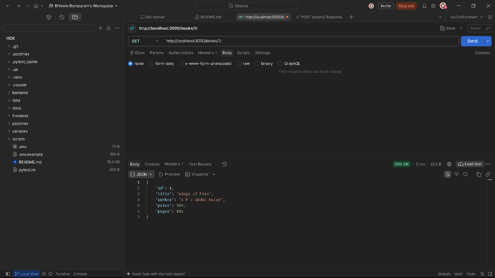
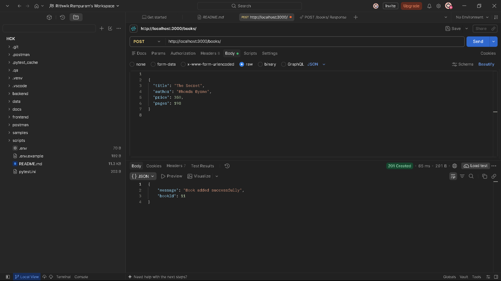
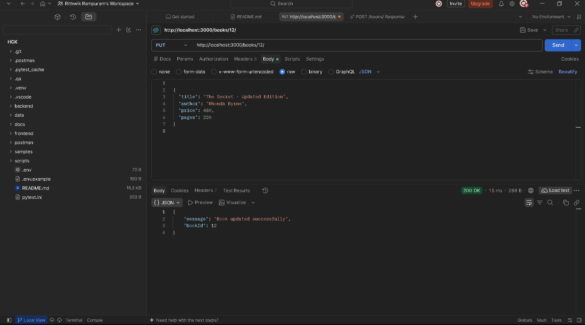
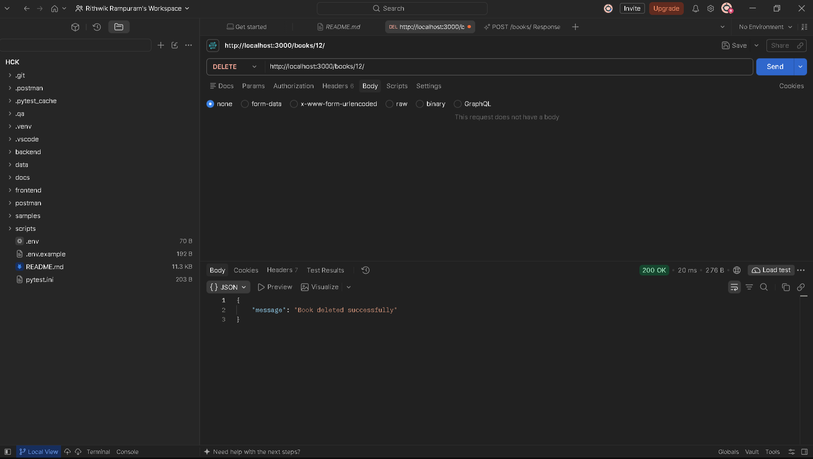
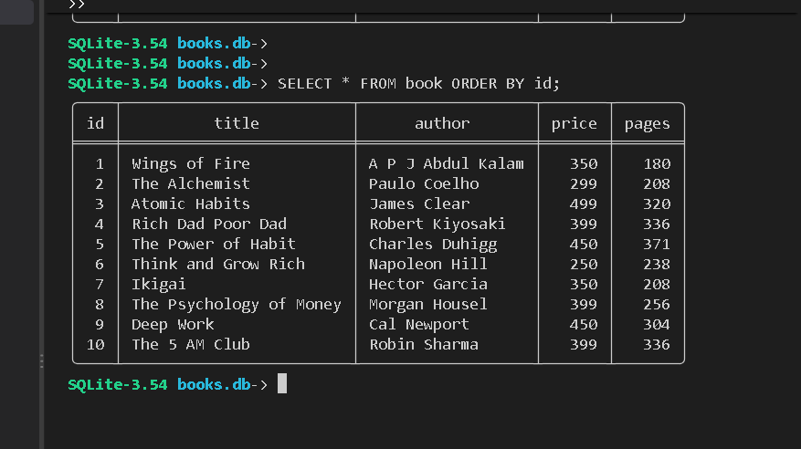

## Student Information

- **Student Name:** Rampuram Rithwik
- **Roll Number:** 252U1R1213
- **Course:** Backend Development Fundamentals
- **Lab Number:** 02

---
# Lab 02 — SQLite Database and CRUD Routes

## Project Description

This project is part of the Backend Development Fundamentals laboratory.

It is a Book Management REST API built using Node.js, Express.js, and SQLite. The application supports creating, reading, updating, and deleting book records.

## Technologies Used

- Node.js
- Express.js
- SQLite and SQLite3
- Nodemon
- Postman

## Database

**Database file:** `books.db`

**Table:** `book`

| Column | Data Type |
|---|---|
| id | INTEGER PRIMARY KEY |
| title | TEXT |
| author | TEXT |
| price | INTEGER |
| pages | INTEGER |

The database contains 10 initial book records inserted using the SQLite command-line interface.

## How to Run

1. Open the `lab-02` folder in VS Code.
2. Open a terminal.
3. Install dependencies:

   `npm install`

4. Start the development server:

   `npx nodemon app.js`

5. The server runs at:

   `http://localhost:3000`

## API Endpoints

| Method | Endpoint | Description |
|---|---|---|
| GET | `/books/` | Retrieve all books |
| GET | `/books/:bookId/` | Retrieve a book by ID |
| POST | `/books/` | Add a new book |
| PUT | `/books/:bookId/` | Update an existing book |
| DELETE | `/books/:bookId/` | Delete a book |

POST and PUT requests accept JSON containing `title`, `author`, `price`, and `pages`.

SQL queries use parameterized placeholders for user-supplied values.

## Testing

All five API endpoints were tested using Chrome and Postman.

A test book was added, updated, and deleted successfully. The original 10 book records remain in the database.

## Project Files

- `app.js` — Express server and CRUD routes
- `setupDB.js` — SQLite database and table setup
- `books.db` — SQLite database
- `package.json` — Project dependencies
- `.gitignore` — Excluded files and folders

## Deployment

The application has been tested locally. A public deployment URL has not yet been configured.

## GitHub Repository

https://github.com/rithwikrampuram7093-eng/RAMPURAM-RITHWIK

## Screenshots

### GET All Books

### GET Single Book

### POST - Add Book

### PUT - Update Book

### DELETE - Remove Book

### SQLite Database - 10 Books

